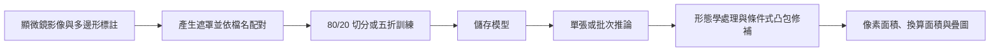

# BioUS-Net：U-Net 分割與面積量測版本紀錄

這個 repository 記錄大學專題中 U-Net 模組的修改過程：從標註資料產生遮罩、訓練分割模型，到單張／批次影像分析與面積匯出。分析對象是**超音波作用於測試片後取得的顯微鏡影像**。

我負責獨立 U-Net 模組的實作、訓練與調整；標註資料由專題組員建立。BPNN、其他分割方法及 GUI 整合脈絡，另見 [Smart-Ultrasound-Cavitation-Predictor](https://github.com/tsengwt1210/Smart-Ultrasound-Cavitation-Predictor)。

## 從哪裡看起

| 檔案 | 用途 |
| --- | --- |
| [Unet.m](Unet.m) | 目前主入口。Attention U-Net、80/20 切分或五折訓練、影像後處理與面積計算 |
| [Unet_V6.m](Unet_V6.m) | 歷史版本。使用 `unetLayers`，保留 ROI 與 FFT 特徵探索流程 |
| [版本比較](docs/versions.md) | 兩支程式的差異、訓練設定與 Git 修改紀錄 |
| [資料格式與輸出](docs/data-format.md) | 標註、檔名配對、像素標籤、Excel 欄位與校正參數 |
| [驗證與限制](docs/validation.md) | 目前檢查範圍、指標解讀及重現實驗仍需保存的資訊 |

`Unet_V6.m` 的檔名沿用早期命名，程式內版本為 v5.4；目前 `Unet.m` 的標頭為 v5.8。**V6 不代表目前最新版本**。

## 目前流程



主程式將影像縮放為 512 × 512 RGB 輸入。推論後把分割結果映射回原始影像大小，再計算連通物件面積；面積換算需要自行提供每像素的實際面積。

## 執行環境

需要 MATLAB 與下列工具箱：

| 工具箱 | 程式使用的功能 |
| --- | --- |
| Deep Learning Toolbox | 網路層、`trainNetwork`、`predict`、訓練設定 |
| Computer Vision Toolbox | `groundTruth`、`pixelLabelDatastore`、`pixelLabelImageDatastore` |
| Image Processing Toolbox | 遮罩、形態學處理、物件分析、色彩擾動與疊圖 |
| Parallel Computing Toolbox（選用） | 平行產生遮罩；原程式遇到平行處理失敗時會改用一般迴圈 |

本次在 MATLAB R2024a Update 3 完成函式可用性與靜態語法檢查，詳見 [驗證紀錄](docs/validation.md)。可先執行 `check_setup` 查看自己的環境；GPU 與完整訓練仍需另外驗證。程式保留原有 MATLAB API，其中 [`pixelLabelImageDatastore`](https://www.mathworks.com/help/vision/ref/pixellabelimagedatastore.html) 已被官方標示為未來移除，升級 MATLAB 時應重新確認相容性。

## 準備與執行

Repository 提供程式與文件。原始影像、標註及訓練權重需另行準備；下載後尚不能直接重現專題結果。

1. 在 MATLAB 將目前資料夾切到此 repository，執行：

   ```matlab
   check_setup
   ```

2. 依 [資料格式](docs/data-format.md) 準備 RGB 影像及 `groundTruth` MAT 檔。預設位置如下：

   ```text
   BioUS-Net/
   ├── data/
   │   ├── images/        # 自備原始影像
   │   └── gTruth.mat     # 自備多邊形標註
   ├── Unet.m
   └── Unet_V6.m
   ```

3. 若資料放在其他位置，先複製本機設定範本，再修改路徑與量測參數：

   ```matlab
   copyfile('config_example.m', 'config_local.m') % 首次設定時執行
   edit config_local.m
   ```

   `config_local.m`、資料、權重和輸出已列入 `.gitignore`。主程式會在設定預設值後載入本機設定。

4. 執行主程式：

   ```matlab
   Unet
   ```

   第一次訓練依序選擇 **[1] 產生標籤遮罩**、**[2] 訓練新模型**。程式會開啟標註檔案選擇視窗，並在訓練選單提供 80/20 切分與五折模式。訓練可能耗時，執行前先檢查資料配對與參數。

5. 已有相容模型時，選 **[3] 批次預測**或 **[4] 單張圖片分析**，載入包含 `net` 與 `classNames` 的 MAT 檔。批次分析新資料請選「新的圖片資料夾」。歷史版本可用 `Unet_V6` 啟動。

主程式的遮罩、Excel 與批次疊圖預設存至 `outputs/attention/`，歷史版存至 `outputs/legacy/`。模型仍依原程式存到 MATLAB 目前資料夾；同日訓練或同資料夾重複分析可能覆寫同名結果，請先備份或另設輸出位置。

## 閱讀結果時要注意

- 目前遮罩流程以背景／單一目標的二類分割為準。多類別遮罩的像素編碼尚未完整處理。
- `RealArea_um2` 以 `PixelArea_px × pixelSize_sq_um` 計算。預設 `1` 是設定值，需經實際尺度校正才能當作 µm²。
- 五折模式讀取每折最後一次有效的 `ValidationAccuracy`；這是像素分類準確率，不能直接稱為 Dice 或 IoU。此處未將既有專題報告數值套用為目前版本的成績。
- 批次選單中的「訓練集／驗證集」會重新產生 80/20 分組，未讀取模型原訓練分組。正式評估應使用另存的資料清單或獨立資料夾，詳見 [驗證與限制](docs/validation.md)。

## 參考方法

- [U-Net 原始論文](https://arxiv.org/abs/1505.04597)：encoder–decoder 與 skip connection 架構。
- [Attention U-Net 原始論文](https://arxiv.org/abs/1804.03999)：attention gate 的方法背景；本庫為 MATLAB 實作與專題調整，未聲稱完整重現該論文結果。
- [本次整理紀錄](CHANGELOG.md)：文件、設定及檢查工具的修改範圍。
